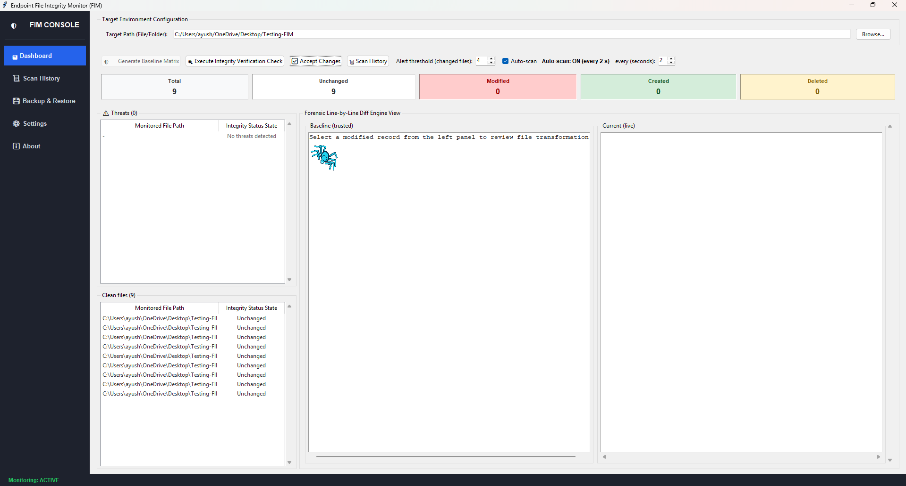
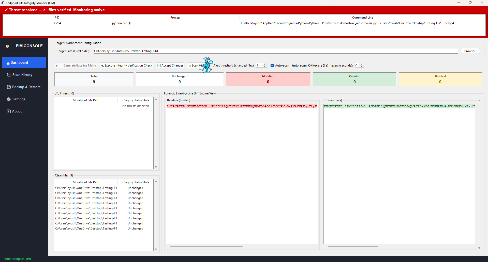
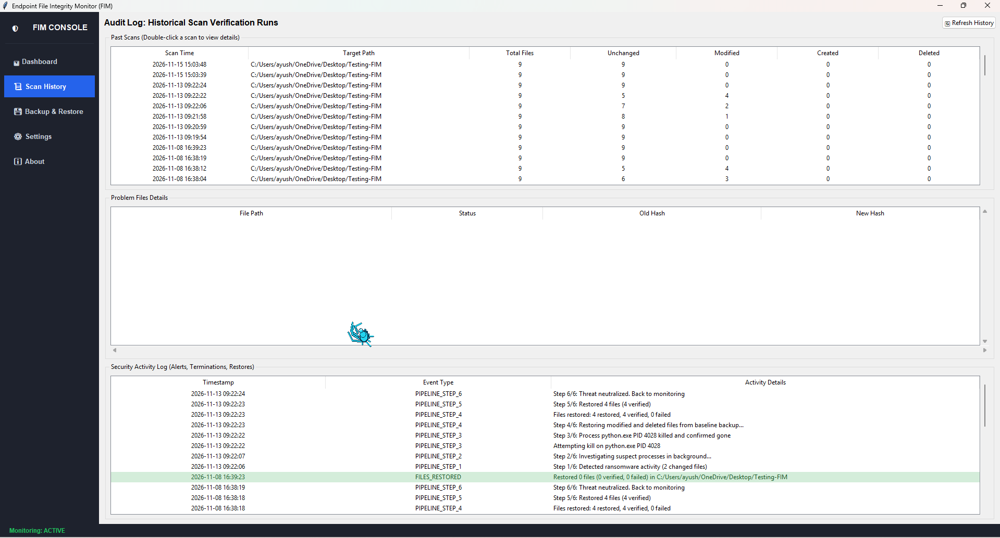
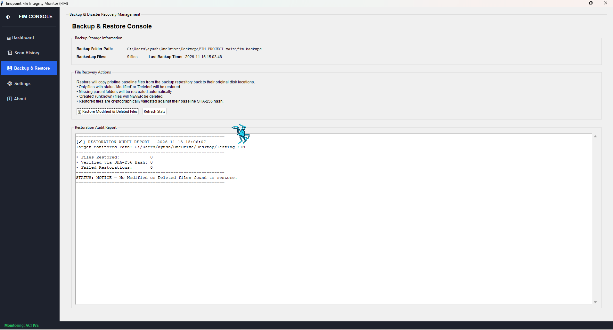
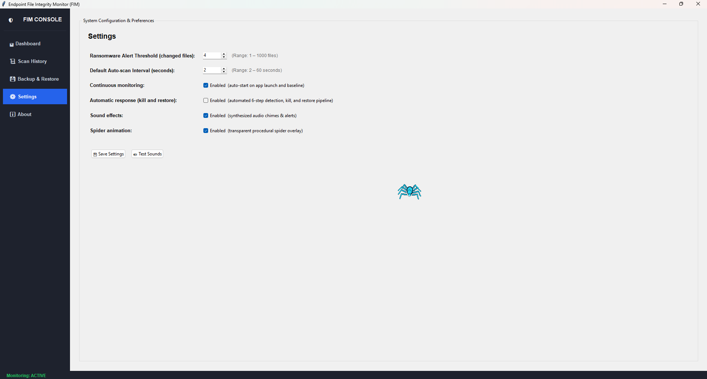

# Endpoint File Integrity Monitor (FIM) & Anti-Tamper Console

> Endpoint File Integrity Monitor and Anti-Tamper Console with automated ransomware response.

[](https://www.python.org/downloads/)
[](LICENSE)
[](https://www.microsoft.com/windows)
[](https://docs.python.org/3/library/tkinter.html)
[](https://www.sqlite.org/)

---

## Overview

The **Endpoint File Integrity Monitor (FIM) & Anti-Tamper Console** is a desktop security solution engineered to continuously audit critical system directories, detect unauthorized modifications, and defend endpoints against fast-moving threats such as ransomware. Built with Python, Tkinter, and an embedded SQLite database, the system establishes a cryptographic baseline of target files, monitors deviations in real time, isolates offending malicious processes via handle inspection, and performs automated, hash-verified recovery to maintain data integrity.

---

## Features

- **SHA-256 Cryptographic Baseline**: Computes block-chunked SHA-256 digests for all files within target directories and caches file contents (up to 1 MB) for differential comparison.
- **4-State Delta Classification**: Accurately classifies file state transitions across scans into `Modified`, `Created`, `Deleted`, and `Unchanged`.
- **Side-by-Side Visual Diff**: Provides an integrated diff viewer highlighting line-by-line additions (green) and deletions (red) between the baseline and altered states.
- **Segregated Threat & Clean Tables**: Surfaces active security anomalies in a dedicated Threat Table while cleanly separating verified, intact assets.
- **Persistent Scan Audit History**: Logs scan summaries, altered file records, detection events, and recovery actions into SQLite for auditability.
- **Threshold-Based Ransomware Alert**: Dynamically triggers high-priority alerts when mass file modifications or deletions exceed configurable burst thresholds.
- **Continuous Auto-Scan Engine**: Supports scheduled periodic background polling with live timer indicators and non-blocking execution.
- **Automated Backup & Hash-Verified Restore**: Automatically archives pristine copies during baseline creation and provides one-click disaster recovery that verifies restored files against original SHA-256 hashes.
- **Two-Stage Process Investigator**: Combines instant command-line heuristic matching (Stage 1) with parallelized, multi-threaded open file handle inspection via `psutil` (Stage 2) to identify suspect processes.
- **Automated Kill & Restore with Safety Rules**: Enables terminating malicious processes directly from the UI, backed by strict OS process exclusion rules and safe restore behaviors.
- **Procedural Spider Overlay & Sound Feedback**: Features an interactive visual spider overlay for alert states and memory-synthesized wave audio feedback for scans, warnings, and recoveries.

---

## Screenshots

> *Note: Place screenshot captures into the `docs/screenshots/` directory using the filenames below.*

### Dashboard Overview


### Ransomware Threat Alert & Active Banner


### Historical Audit Trail


### Backup & Verification Center


### Settings & Threshold Configuration


---

## How It Works

### Operational Workflow
1. **Baseline**: Calculate SHA-256 hashes for all target files and store snapshots in `fim_backups/` and baseline metadata in SQLite.
2. **Scan**: Interrogate target directory on demand or via continuous timer to compute current cryptographic hashes.
3. **Classify**: Compare current filesystem state against baseline records to categorize entries into Modified, Created, Deleted, or Unchanged.
4. **Alert**: If altered file count exceeds the configured burst limit, sound an alarm and engage the global warning banner.
5. **Investigate**: Perform two-stage process inspection to pinpoint executable handles locking or writing into the target folder.
6. **Kill**: Terminate confirmed attacker processes while enforcing strict critical process protections.
7. **Restore**: Roll back altered/deleted files from verified backup images and validate hashes against the pristine baseline.

### System Architecture

```text
+--------------------------------------------------------------------------+
|                            Tkinter Desktop UI                            |
|    (Dashboard, Diff View, Threat Tables, History, Settings, Overlay)     |
+------------------------------------+-------------------------------------+
                                     |
                                     v
+--------------------------------------------------------------------------+
|                         FIM Orchestration Engine                         |
|                         (core/fim_engine.py)                             |
+---------+--------------------------+--------------------------+----------+
          |                          |                          |
          v                          v                          v
+-------------------+      +-------------------+      +-------------------+
| Cryptographic     |      | Backup & Rollback |      | Process Detective |
| Hasher (SHA-256)  |      | Manager           |      | (psutil 2-stage)  |
| (core/hasher.py)  |      | (backup_mgr.py)   |      | (proc_monitor.py) |
+---------+---------+      +---------+---------+      +---------+---------+
          |                          |                          |
          +--------------------+     |     +--------------------+
                               |     |     |
                               v     v     v
+--------------------------------------------------------------------------+
|                        Storage & Persistence                             |
|          SQLite Database (fim_repository.db) & fim_backups/             |
+--------------------------------------------------------------------------+
```

---

## Project Structure

```text
.
├── main.py                     # Application entry point and dependency wiring
├── requirements.txt            # Python dependencies (psutil)
├── LICENSE                     # MIT License documentation
├── README.md                   # Comprehensive project documentation
├── .gitignore                  # Git exclusions for DB, backups, and caches
├── core/
│   ├── hasher.py               # Chunked SHA-256 calculation & text extractor
│   ├── fim_engine.py           # Integrity evaluation and state delta engine
│   ├── backup_manager.py       # Snapshot backup and hash-verified restore
│   └── process_monitor.py      # Two-stage process investigator & handle scanner
├── db/
│   └── db_manager.py           # SQLite database schema, history, and settings
├── gui/
│   ├── app.py                  # Main container, navigation, and global alert banner
│   ├── dashboard_page.py       # Live scan tables, diff viewer, and controls
│   ├── history_page.py         # Timestamped scan runs and security audit logs
│   ├── backup_page.py          # Backup status, verification, and restore UI
│   ├── settings_page.py        # Scan frequency, threshold, and audio controls
│   ├── about_page.py           # System information, architecture, and team credits
│   ├── confirm_dialog.py       # Custom modal confirmation dialogs
│   ├── main_window.py          # Window framing and root helper utilities
│   ├── sounds.py               # Memory-synthesized procedural audio sound effects
│   ├── spider_overlay.py       # Transparent click-through canvas overlay
│   └── theme.py                # Color palette and UI styling constants
├── demo/
│   └── fake_ransomware.py      # Harmless educational ransomware simulation tool
└── docs/
    └── screenshots/
        └── .gitkeep            # Screenshot directory placeholder
```

---

## Installation & Usage

### Prerequisites
- **Python 3.11** (or compatible Python 3.10+)
- **Windows OS** (required for handle investigation and transparency features)
- **Git**

### Installation
1. Clone the repository:
   ```bash
   git clone https://github.com/playertap6-sudo/endpoint-file-integrity-monitor.git
   cd endpoint-file-integrity-monitor
   ```

2. Install dependencies:
   ```bash
   pip install -r requirements.txt
   ```

3. Launch the application:
   ```bash
   python main.py
   ```

### Step-by-Step Usage Guide
1. **Define Target Directory**: Enter or browse to the folder you wish to monitor in the Dashboard top bar.
2. **Generate Baseline**: Click **Generate Baseline**. The engine hashes all files, creates an SQLite baseline, and archives a pristine snapshot.
3. **Verify Integrity**: Click **Scan Target** to perform an on-demand integrity audit.
4. **Enable Continuous Monitoring**: Check **Auto-scan** and specify an interval (e.g., 2–5 seconds) to track changes in real time.
5. **Inspect Modifications**: If a file is modified, select it in the Threat Table to view line-by-line differences in the diff pane.
6. **Investigate & Remediate**: If an alert fires, click **Investigate Processes** to inspect locking handles, terminate rogue processes, and click **Restore Now** to revert corrupted files.

---

## Demo: Testing Ransomware Detection

A harmless simulation script is provided in `demo/fake_ransomware.py` strictly for classroom and testing purposes.

### Safety Rules for Demo Execution
- **Always target an isolated test folder** (e.g., `C:\demo_target` or a dedicated test folder on your Desktop).
- Never point the demo script at root drives or production folders.
- The simulator uses reversible base64 encoding and touches only `.txt` files.

### Demo Steps
1. Create a test directory with sample text files:
   ```bash
   mkdir C:\test_fim
   echo "Important confidential record 1" > C:\test_fim\file1.txt
   echo "Important confidential record 2" > C:\test_fim\file2.txt
   echo "Important confidential record 3" > C:\test_fim\file3.txt
   ```
2. Open the FIM application, enter `C:\test_fim`, click **Generate Baseline**, and toggle **Auto-scan** to `ON`.
3. In a separate terminal, launch the simulator with the `--delay` parameter (specifies the seconds to hold handles open so the process monitor can capture them):
   ```bash
   python demo/fake_ransomware.py C:\test_fim --delay 3
   ```
4. Type `YES` when prompted to initiate the test.
5. Watch the FIM console trigger a **Ransomware Alert Banner**. Click **Investigate Processes**, select `fake_ransomware.py`, click **Kill Selected Process**, and then click **Restore Now** to revert all files back to their pristine baseline.

---

## Safety and Limitations

### Safety Safeguards
- **Protected Process Whitelist**: Hardcoded protections prevent terminating critical operating system processes (`explorer.exe`, `svchost.exe`, `system`, `csrss.exe`, `wininit.exe`, `winlogon.exe`, `services.exe`, `lsass.exe`).
- **Self-Termination Prevention**: The engine explicitly blocks killing its own process ID (`os.getpid()`).
- **Conservative Restoration Policy**: The rollback engine only restores files tracked in the baseline. It **never deletes unknown or newly created files**, preventing accidental data loss of legitimate user work.

### Technical Limitations
- **User-Space Storage**: The SQLite database (`fim_repository.db`) is stored locally in user space; in an enterprise deployment, a tamper-proof or remote datastore would be required.
- **Polling Interval Latency**: Polling-based auto-scan introduces a detection window equal to the poll frequency (e.g., 2 seconds) compared to kernel-level filesystem mini-filters.
- **Platform Dependencies**: Process handle scanning and GUI transparency mechanisms are optimized for the Microsoft Windows environment.

---

## Ethical Use Disclaimer

> **DISCLAIMER**: This software and its demonstration scripts are created solely for academic, educational, and authorized defensive testing purposes. The demonstration simulator (`demo/fake_ransomware.py`) is completely harmless, utilizes reversible encoding, and contains hard safeguards against accidental execution on system drives. Do not use this tool or techniques derived from it on any system without explicit authorization from the system owner.

---

## Roadmap

- [ ] **Kernel-Level Filesystem Driver**: Integrate Windows Minifilter / USN Journal / eBPF callbacks for sub-millisecond, zero-polling detection.
- [ ] **Digitally Signed Baselines**: Implement public-key digital signatures and HMAC verification to harden baselines against local tampering.
- [ ] **Shannon Entropy Analysis**: Incorporate real-time Shannon file entropy computation to detect high-entropy encrypted blobs instantly.
- [ ] **Enterprise Database Support**: Add client connectors for remote MySQL, PostgreSQL, and SIEM ingestion (Syslog / Elastic).

---

## Authors

- **Ayush Kumar Sharma** — SRM Institute of Science and Technology
- **Dipayan Kumar** — SRM Institute of Science and Technology
- **Shivangi Kumari** — SRM Institute of Science and Technology

---

## License

This project is licensed under the MIT License - see the [LICENSE](LICENSE) file for details.
